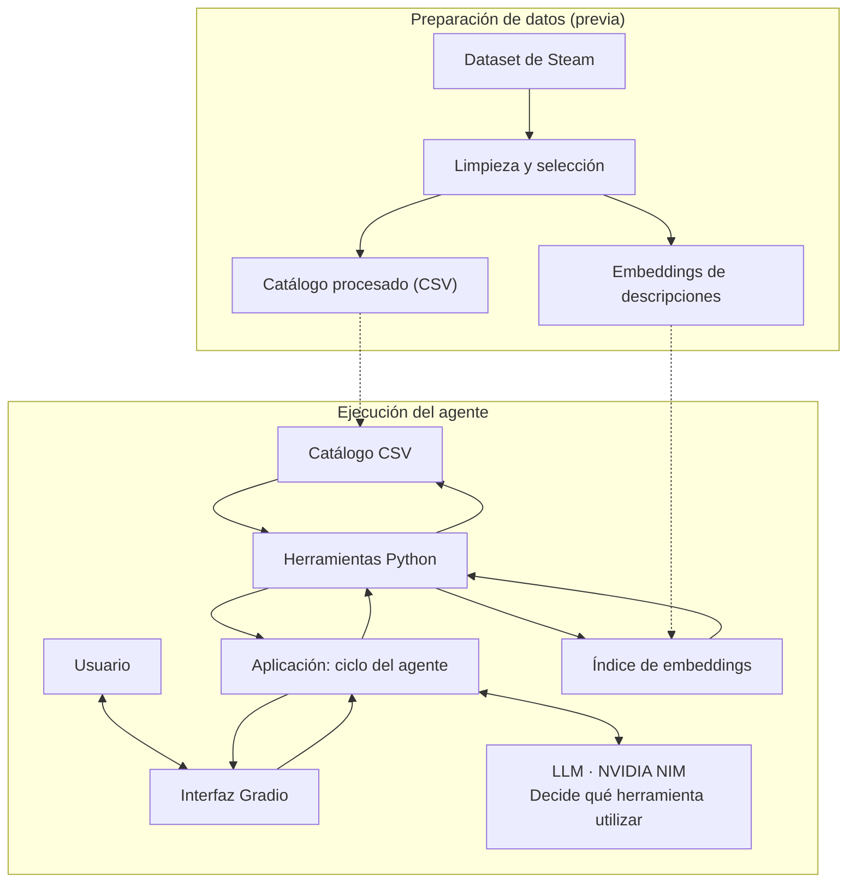

# Asistente conversacional para descubrir videojuegos

**Proyecto final Inteligencia Artificial
Opción B: agente con herramientas**

**Integrantes:** David Ramírez Agudelo, Laura Ortiz Usme, Samuel Hernando Echeverri

## 1. Descripción del proyecto

Elegir un videojuego puede ser difícil cuando una persona tiene una idea
general de lo que quiere, pero no conoce los géneros o etiquetas que
debería buscar. Por ejemplo: «quiero algo relajante para jugar con mis
amigos y que funcione en Mac».

Este proyecto propone un agente conversacional que interpreta
solicitudes en lenguaje natural y consulta un catálogo de videojuegos de
Steam. Según la tarea, el modelo de lenguaje selecciona herramientas
para filtrar juegos, buscar por similitud semántica, consultar la ficha
de un título o calcular precios. La aplicación ejecuta las herramientas
y devuelve sus resultados al modelo, que formula una recomendación
basada en los datos consultados.

El prototipo está dirigido a jugadores que necesitan ayuda para traducir
sus preferencias a criterios de búsqueda.

## 2. Problema y solución

Las tiendas de videojuegos suelen organizar sus filtros mediante
categorías y etiquetas predeterminadas. Sin embargo, los jugadores
pueden describir lo que buscan mediante sensaciones, situaciones o
preferencias expresadas libremente. Convertir esas descripciones en
filtros concretos requiere conocer las categorías de la tienda y puede
hacer que la búsqueda resulte lenta o frustrante.

La solución consiste en un agente que interpreta la solicitud, decide
qué herramientas utilizar y combina búsquedas semánticas con filtros y
operaciones sobre los datos. Para evitar recomendaciones sin respaldo,
el agente solo debe recomendar títulos devueltos por las herramientas y
presentar sus precios y sistemas operativos a partir del catálogo.

## 3. Alcance

### Funcionalidades incluidas

| Tarea | Ejemplo | Herramienta |
|---|---|---|
| Búsqueda con criterios concretos | «Un shooter cooperativo por menos de 10 USD» | `buscar_juegos` |
| Búsqueda por descripción libre | «Algo relajante, parecido a un juego de granja» | `buscar_similares` |
| Consulta de un título | «¿Cuánto cuesta y en qué sistemas funciona [juego]?» | `detalle_juego` |
| Cálculo de precios | «¿Cuánto cuestan juntos estos tres juegos?» | `calcular_total` |
| Solicitud combinada | «Busca juegos relajantes por menos de 15 USD en Mac y calcula cuánto cuestan los dos primeros» | Varias herramientas |

En este proyecto, **plataforma** se refiere a sistema operativo de PC:
Windows, macOS o Linux. El catálogo corresponde a Steam; no incluye
consolas ni otras tiendas.

### Fuera del alcance

- Comprar juegos, generar enlaces de pago o integrarse con la tienda de Steam.
- Consultar precios o disponibilidad en tiempo real.
- Analizar reseñas completas u opiniones de usuarios.
- Personalizar recomendaciones mediante el historial o la cuenta del jugador.
- Consultar catálogos de consolas, dispositivos móviles u otras tiendas.
- Implementar varios agentes o desplegar el sistema como servicio de producción.

## 4. ¿Por qué un agente con herramientas?

Se eligió la **opción B: agente con herramientas**, en lugar de un
sistema RAG, porque las solicitudes combinan dos tipos de información:

- **Preferencias semánticas:** por ejemplo, «relajante», «aventura tranquila» o «para jugar con amigos».
- **Condiciones verificables:** por ejemplo, un precio máximo o la compatibilidad con macOS.

El catálogo es una tabla estructurada con información de los juegos. Por
ello, los filtros exactos, las consultas de fichas y los cálculos se
resuelven directamente sobre los datos. La búsqueda semántica
complementa estas operaciones cuando la persona describe lo que quiere
sin utilizar las etiquetas de Steam.

El elemento central es la decisión del modelo: seleccionar una
herramienta, proporcionar sus argumentos, interpretar el resultado y
decidir si necesita otra llamada. `buscar_similares` utiliza embeddings,
pero es una herramienta dentro del agente; no convierte el sistema en un
RAG.

## 5. Datos

**Fuente principal:** [Steam Games Dataset — FronkonGames](https://huggingface.co/datasets/FronkonGames/steam-games-dataset),
publicado en Hugging Face. Se conservará la atribución correspondiente a la fuente.

> **Licencia (ficha consultada el 2026-11-11, revisión `6c21457`).** Los metadatos de la ficha declaran
> `license: mit`. El único texto de la ficha que menciona una licencia es *"This dataset has been created with
> [this code](https://github.com/FronkonGames/Steam-Games-Scraper) (MIT)"*, es decir, MIT se refiere al código
> de recolección; la ficha no establece términos adicionales para los datos ni menciona CC-BY (una versión previa
> de este README indicaba CC-BY-4.0 por error). Los textos e imágenes de las fichas de Steam pertenecen a sus
> respectivos titulares; aquí se usan con fines académicos y se conserva la atribución a FronkonGames.

**Selección del catálogo:** recorte de hasta 1.000 juegos con descripción disponible y en inglés,
priorizando los títulos con mayor número de reseñas (`positive + negative`). Criterios aplicados por
`scripts/prepare_data.py`, que registra en `data/catalog_info.json` la fuente, la revisión del dataset, la
fecha de consulta y los conteos tras cada paso:

1. El título es válido y el precio es numérico y no negativo.
2. El inglés figura entre los idiomas soportados (`supported_languages`).
3. Descripción de al menos 60 caracteres: `short_description` o, si es muy breve, `detailed_description` sin HTML.
4. La descripción está en inglés (heurística: proporción de caracteres ASCII y de palabras funcionales en inglés).
5. Sin duplicados por título (se conserva el de más reseñas).
6. Los N primeros por número de reseñas (N = 1.000 por defecto).

**Campos utilizados** (nombres confirmados contra el visor del dataset; el original tiene 41 columnas en `snake_case`):

| Catálogo procesado | Columna original |
|---|---|
| `app_id` | `appID` |
| `name` | `name` |
| `description` | `short_description` / `detailed_description` |
| `genres` | `genres` (lista; se guarda separada por `\|`) |
| `tags` | `Tags` de `games.csv` (ver nota) |
| `price` | `price` (USD) |
| `windows`, `mac`, `linux` | `windows`, `mac`, `linux` |
| `positive`, `negative` | `positive`, `negative` |
| `release_date` | `release_date` (normalizada a `AAAA-MM-DD`) |

**Preparación de datos:**

1. Descargar el conjunto de datos y documentar su versión o fecha de consulta (`prepare_data.py` lo hace).
2. Seleccionar los registros según el criterio definido.
3. Normalizar los tipos de datos, especialmente el precio y las listas de géneros y etiquetas.
4. Eliminar duplicados y registros sin descripción.
5. Guardar el catálogo procesado (`data/catalog.csv`).
6. Generar una sola vez los embeddings de las descripciones y almacenarlos para reutilizarlos (`build_embeddings.py`).

**Nota sobre las etiquetas.** En la versión parquet del dataset (la que carga `datasets`), la columna `tags`
llega vacía en las 124.146 filas: en `games.json` las etiquetas son un diccionario `{etiqueta: votos}` que no
sobrevivió a la conversión. `prepare_data.py` lo detecta y completa las etiquetas por `appID` desde `games.csv`
de la misma revisión, corrigiendo su cabecera desalineada (`DiscountDLC count` fusiona dos columnas: 39 nombres
para 40 valores). Se verificó que las etiquetas, el precio y la compatibilidad con macOS de los 1.000 juegos del
catálogo coinciden con `games.csv`.

**Conteos reales** (ejecución del 2026-11-11, `data/catalog_info.json`): 124.146 registros → 124.145 con título
y precio válido → 110.602 con inglés soportado → 110.527 con descripción → 109.046 con descripción en inglés →
107.262 sin duplicados → **1.000** en el catálogo (todos con etiquetas). 152 de ellos tienen precio 0.

El catálogo es una captura fija: los precios y demás datos pueden no coincidir con los disponibles actualmente
en Steam. El precio es el que figuraba en la fecha de recolección, **incluido el descuento vigente** en ese
momento (p. ej., Stardew Valley aparece a 8,99 USD con un 40 % de descuento). Algunos valores de la fuente
llaman la atención y no se corrigieron (p. ej., *Grand Theft Auto V Legacy* figura con precio 0).

**Catálogo de muestra.** El repositorio incluye `data/sample_games.csv`, con **43 juegos ficticios** y el mismo
esquema, para probar el sistema sin descargar nada. Sus datos son inventados y no deben presentarse como resultados
reales. Si existe `data/catalog.csv`, la aplicación lo usa en su lugar; el repositorio **ya incluye** el catálogo real
procesado y su índice de embeddings, de modo que no hace falta regenerarlos para usar la aplicación.

## 6. Arquitectura

El sistema se organiza en dos procesos: **preparación de datos**, que se
realiza antes de ejecutar el agente, y **consulta**, que se repite cada
vez que el usuario envía una solicitud.



### Ciclo de ejecución

1. El usuario envía una solicitud desde la interfaz.
2. La aplicación envía al modelo el mensaje, el historial pertinente (últimos 6 turnos, solo texto) y las descripciones de las herramientas disponibles.
3. El modelo decide si puede responder o si necesita solicitar una herramienta.
4. Cuando solicita una herramienta, la aplicación valida sus argumentos, la ejecuta y registra el nombre, los argumentos y el resultado.
5. La aplicación devuelve el resultado al modelo, que puede responder o solicitar otra herramienta.
6. El ciclo termina cuando el modelo produce una respuesta final o se alcanza el límite de llamadas.
7. La interfaz muestra la respuesta y la traza de ejecución.

### Límite de llamadas y errores

Se establece un máximo de **cinco llamadas a herramientas por solicitud
del usuario** (`MAX_TOOL_CALLS`). Se considera que el límite se alcanza cuando el modelo pide una llamada
adicional: esa llamada **no se ejecuta**, la aplicación le responde con un aviso de límite y realiza una última
consulta al modelo sin habilitar herramientas, para que responda con la información reunida y advierta que la
búsqueda quedó incompleta. Si el modelo no lo menciona, la interfaz añade el aviso. Cinco llamadas exactas que
resuelven la tarea no cuentan como búsqueda incompleta.

Las herramientas validan sus argumentos y devuelven resultados
estructurados. Casos como un juego inexistente, argumentos inválidos o
una búsqueda sin coincidencias se comunican al modelo como
resultados controlados (`ok: false` + `tipo_error`), en lugar de interrumpir el ciclo con una
excepción no gestionada. Los fallos de red o de la API del modelo se capturan y se muestran como mensaje en el chat.

## 7. Herramientas

Las cuatro herramientas se implementan como funciones Python
independientes (`src/tools.py`) y se describen al modelo mediante esquemas de function
calling.

| Herramienta | Propósito | Argumentos principales | Resultado |
|---|---|---|---|
| `buscar_juegos` | Aplicar filtros exactos al catálogo | `genero`, `tags`, `precio_max`, `plataforma`, `limite` | Juegos que cumplen los criterios, con sus datos relevantes |
| `buscar_similares` | Encontrar descripciones cercanas semánticamente a una solicitud | `descripcion`, `k`, filtros opcionales | Juegos más similares y puntajes de similitud |
| `detalle_juego` | Consultar la ficha de un título | `nombre` | Datos del juego o aviso de que no se encontró |
| `calcular_total` | Calcular el costo de varios títulos | `nombres` | Precios individuales, suma y promedio, o aviso de títulos no encontrados |

`buscar_juegos` se encarga de las condiciones exactas;
`buscar_similares` identifica cercanía de significado. Cuando una
solicitud combina ambas, el diseño asegura que los filtros
obligatorios —como precio máximo y sistema operativo— se apliquen y
verifiquen, aunque también se utilice similitud semántica: los filtros se aplican **antes** de ordenar por
similitud (así siempre se devuelven hasta `k` juegos válidos) y luego se **re-verifican fila a fila** con una
implementación independiente. El resultado incluye `verificacion_filtros`.

`calcular_total` recibe nombres de juegos y consulta sus precios en el
catálogo. No recibe expresiones de código ni precios inventados por el
modelo; cualquier argumento no declarado se rechaza.

**Detalles de comportamiento** (cubiertos por las pruebas automatizadas):

- `precio_max` es inclusivo (precio ≤ máximo); `0` devuelve solo juegos gratuitos. `tags` exige **todas** las etiquetas.
- Orden de `buscar_juegos`: las etiquetas de Steam vienen ordenadas por votos, así que, si se piden etiquetas, primero van
  los juegos en los que **todas** están entre las 5 más votadas, luego entre las 10 más votadas y luego el resto; dentro
  de cada grupo, por reseñas positivas (la popularidad desempata). Sin etiquetas, el orden es solo por popularidad.
  Este criterio se introdujo tras la evaluación real (ver «Análisis de resultados»).
- `plataforma` acepta sinónimos (`mac`, `macOS`, `OS X`…) y se normaliza a `windows | mac | linux`.
- Si un género o etiqueta no existe, la herramienta devuelve el vocabulario válido para que el modelo se corrija (p. ej., «shooter» es una etiqueta, no un género).
- Los títulos se comparan sin distinguir mayúsculas, tildes ni signos, pero **solo por coincidencia exacta**: un título parecido nunca se toma por el pedido; se ofrece como sugerencia (siempre títulos reales del catálogo).
- `calcular_total` suma en centavos enteros (evita errores como `0.1 + 0.2 + 0.3 = 0.6000000000000001`), ignora duplicados y avisa de los títulos no encontrados.
- Las descripciones del catálogo están en inglés: el esquema de `buscar_similares` indica al modelo que redacte `descripcion` en inglés aunque el usuario escriba en español.

## 8. Tecnologías

| Tecnología | Uso |
|---|---|
| Python | Implementación del agente y las herramientas |
| NVIDIA NIM | Modelo de lenguaje con function calling: `mistralai/mistral-large-4-1t-a52b` (Mistral Large 4; usado en toda la evaluación, probado el 2026-11-11; configurable con `NVIDIA_LLM_MODEL`) |
| NVIDIA NIM — embeddings | Representación vectorial de descripciones: `nvidia/nemotron-3.5-embed-1b` (2048 dimensiones; índice generado el 2026-11-11; configurable con `NVIDIA_EMBED_MODEL`). Requiere `input_type`: `passage` para el catálogo y `query` para las consultas |
| Cliente `openai` | Comunicación con la API compatible de NVIDIA NIM (`https://integrate.api.nvidia.com/v1`) |
| pandas / numpy | Lectura, limpieza y filtrado del catálogo; similitud coseno |
| Gradio | Interfaz conversacional y panel de trazabilidad |
| python-dotenv | Lectura de variables de entorno |
| Steam Games Dataset | Fuente del catálogo |

> **Elección de modelos (2026-11-11).** Los modelos previstos inicialmente ya no están disponibles: la API
> responde `410 Gone` con *"`meta/llama-3.3-70b-instruct` has reached its end of life on 2026-08-26"* y
> *"`nvidia/llama-3.2-nv-embedqa-1b-v2` … on 2026-05-18"*. Con la cuenta gratuita se probaron 16 modelos de
> lenguaje con una petición de function calling; 8 no están disponibles para la cuenta (404) y varios tardaron más
> de 60 s. Tres respondieron en ~3 s con una llamada válida y resolvieron el caso 1 completo con el catálogo de
> muestra (4/4 juegos correctos): `mistralai/mistral-large-4-1t-a52b` (elegido: respuesta más completa y sin
> afirmaciones sin respaldo), `nvidia/nemotron-3-ultra-550b-a55b` y `nvidia/nemotron-3.5-lightning-30b-a3b`. Para
> embeddings se eligió `nvidia/nemotron-3.5-embed-1b`. Cambiar de modelo solo requiere `NVIDIA_LLM_MODEL` /
> `NVIDIA_EMBED_MODEL` (al cambiar el de embeddings hay que regenerar el índice).

## 9. Interfaz

Interfaz web en Gradio (`src/app.py`), ejecutable localmente o en Google Colab. Tiene dos áreas principales:

- **Conversación:** historial de mensajes, campo para escribir solicitudes, botones de envío y de limpieza, y ejemplos de consultas.
- **Traza de herramientas:** lista de llamadas realizadas (desplegables con argumentos y resultados en JSON), estado ✓/✗ de cada una, duración y contador de llamadas respecto al máximo permitido.

La respuesta presenta los juegos recomendados como lista con nombre, precio, sistemas operativos y géneros. La traza permite consultar los argumentos y resultados de cada llamada, sin
ocultar los casos en los que no hubo resultados o se produjo un error, y muestra una advertencia cuando se alcanza el límite. Si falta la clave de la API, la interfaz abre igualmente y avisa en el chat.

## 10. Instalación y ejecución

1. Clonar el repositorio (el proyecto está en la rama `proyecto-final-videojuegos`) e instalar las dependencias:

   ```bash
   git clone -b proyecto-final-videojuegos https://github.com/lauraortizusme/IntroAI_2026.git steam-game-agent
   cd steam-game-agent
   pip install -r requirements.txt
   ```

2. Crear un archivo `.env` a partir de `.env.example` y configurar la clave:

   ```env
   NVIDIA_API_KEY=tu_clave_aqui
   ```

   En Google Colab se utilizarán los secretos del entorno. **No se
   deben incluir claves reales en el código, los notebooks ni el
   repositorio.**

3. Datos (ver `data/README.md`). El repositorio incluye el catálogo real (`data/catalog.csv`) y su índice de
   embeddings, así que este paso es **opcional**. Para regenerarlos desde el dataset:

   ```bash
   pip install -r requirements-data.txt
   python scripts/prepare_data.py          # → data/catalog.csv y data/catalog_info.json
   python scripts/build_embeddings.py      # → data/catalog.embeddings.npy/.json (NVIDIA NIM, una sola vez)
   ```

   Para búsqueda semántica real sobre el catálogo de muestra, también conviene ejecutar
   `python scripts/build_embeddings.py --catalog data/sample_games.csv` (el índice incluido usa un sustituto
   léxico sin red, apto solo para pruebas).

4. Ejecutar la aplicación:

   ```bash
   python src/app.py
   ```

   Opciones: `--share` (enlace público temporal), `--port N`, `--catalog ruta.csv`.

**Google Colab:** abrir `notebooks/steam_agent_colab.ipynb`, crear el secreto `NVIDIA_API_KEY` y ejecutar las celdas
en orden (instala dependencias, obtiene el código, prepara datos y embeddings, prueba el agente y lanza Gradio).

**Reproducir todo desde cero (Windows, cmd):**

```bat
git clone -b proyecto-final-videojuegos https://github.com/lauraortizusme/IntroAI_2026.git steam-game-agent
cd steam-game-agent
py -3.11 -m venv .venv
.venv\Scriptsctivate
python -m pip install -r requirements-dev.txt -r requirements-data.txt
copy .env.example .env
notepad .env
python -m pytest
python scripts\prepare_data.py
python scriptsuild_embeddings.py
python scripts
un_evaluation.py
python srcpp.py
```

En `notepad .env` se escribe la clave en `NVIDIA_API_KEY`. `prepare_data.py` (descarga ≈590 MB) y
`build_embeddings.py` (≈32 peticiones) son opcionales porque el repositorio ya incluye los datos; `prepare_data.py`
usa la última revisión del dataset, así que si cambió, el catálogo puede diferir y hay que regenerar los embeddings.
`run_evaluation.py` también es opcional (≈15 peticiones; se puede ejecutar por partes con `--only`).

Variables opcionales: `NVIDIA_BASE_URL`, `NVIDIA_LLM_MODEL`, `NVIDIA_EMBED_MODEL`, `MAX_TOOL_CALLS`, `CATALOG_PATH`.

## 11. Pruebas y resultados

### Pruebas automatizadas (no requieren clave ni red)

```bash
pip install -r requirements-dev.txt
python -m pytest
```

**106 pruebas, todas pasan** (última ejecución: 2026-11-12). Cubren: filtros y su verificación, orden por relevancia
de etiquetas con la popularidad como desempate, búsqueda semántica con filtros obligatorios, fichas, totales (incluidos
títulos inexistentes y aritmética en centavos), validación de argumentos y errores controlados, ciclo del agente con un
modelo simulado (traza, argumentos inválidos, límite de cinco llamadas, llamadas en paralelo que lo exceden, errores de
red), formato exacto de las peticiones de embeddings a NVIDIA NIM, integridad del índice, preparación de datos con un
archivo crudo sintético de 41 columnas (incluida la recuperación de etiquetas desde `games.csv` con su cabecera
desalineada, también para archivos locales, y la conservación de apóstrofos como en *Beat 'em up*), la interfaz
Gradio, el script de evaluación (incluido el recálculo de chequeos sin llamar a la API) y el notebook de Colab
(sincronizado con su generador, celdas de código sintácticamente válidas y sin descargas por defecto).

**Qué NO demuestran:** el comportamiento del modelo de lenguaje real. Con un modelo simulado se comprueba que la
aplicación ejecuta y registra correctamente lo que el modelo pide, no que el modelo elija bien las herramientas.
Eso lo mide la evaluación manual siguiente.

### Evaluación manual con el modelo real

La evaluación es manual. En cada caso se comparó la respuesta con el catálogo y con los resultados de las
herramientas: si la herramienta seleccionada fue adecuada, si sus argumentos representan la solicitud y si la
respuesta final coincide con los datos devueltos.

| # | Categoría | Solicitud | Resultado esperado |
|---|---|---|---|
| 1 | Habitual: filtros | «Un shooter cooperativo por menos de 10 USD» | Los resultados cumplen los filtros disponibles en el catálogo. |
| 2 | Habitual: semántica | «Quiero algo para relajarme» | Las recomendaciones son coherentes con la descripción y aparecen en los resultados de la herramienta. |
| 3 | Habitual: combinada | «Recomiéndame tres juegos de granja y dime cuánto cuestan juntos» | Se identifican los juegos y el total coincide con la suma de sus precios en el catálogo. |
| 4 | Consulta que requiere herramienta | «¿En qué sistemas operativos funciona [juego del catálogo] y cuánto cuesta?» | La ficha coincide con los datos del catálogo. |
| 5 | Caso límite | «¿Cuánto cuesta [título que no está en el catálogo]?» | El agente reconoce que no encuentra el título y no inventa información. |
| 6 | Prueba adicional: límite de llamadas | Solicitud que provoque más de cinco llamadas | El agente responde con lo reunido e informa que la búsqueda quedó incompleta. |

Para ejecutarlos todos con el agente real y guardar la evidencia:

```bash
python scripts/run_evaluation.py              # o: --only 3,5
python scripts/run_evaluation.py --recheck results/evaluacion_<fecha>.json   # recalcula chequeos, sin API
```

El script sustituye los marcadores (caso 4: el juego con más reseñas del catálogo; caso 5: un título inventado que
verifica que no exista; caso 6: pedir siete fichas por separado), guarda la traza completa en
`results/evaluacion_<fecha>.json` y genera `results/evaluacion_<fecha>.md` con la respuesta, las herramientas
llamadas, sus argumentos y unos chequeos objetivos de apoyo (títulos mencionados sin respaldo en las herramientas,
coincidencia del total, etc.). **La valoración queda en blanco para completarla a mano.**

Para cada caso se registran la respuesta obtenida, las herramientas llamadas con sus argumentos y una valoración
(**correcto, parcial o incorrecto**) con su justificación. La traza completa (incluidos los resultados de cada
llamada) se incluye para los casos 3 y 6 en el anexo enlazado abajo.

#### Resultados (2026-11-11 · `mistralai/mistral-large-4-1t-a52b` · catálogo real de 1.000 juegos · máximo 5 llamadas)

Evidencia: [`results/evaluacion_20261111_172348.md`](results/evaluacion_20261111_172348.md) (los seis casos),
[`results/evaluacion_20261111_173037.md`](results/evaluacion_20261111_173037.md) y
[`results/evaluacion_20261111_174341.md`](results/evaluacion_20261111_174341.md) (casos 1 y 3 repetidos con el código
final, tras la mejora descrita en el análisis; la ejecución de los seis casos queda como evidencia «antes») y
[`results/evaluacion_20261111_173115.md`](results/evaluacion_20261111_173115.md) (caso 6 con `MAX_TOOL_CALLS=2`).
**Trazas completas** (herramienta, argumentos y resultado de cada llamada) del caso 3 (antes y después) y del caso 6:
[`results/anexo_trazas_casos_3_y_6.md`](results/anexo_trazas_casos_3_y_6.md). Cada respuesta se contrastó con los
resultados de las herramientas y con `data/catalog.csv`. Los chequeos automáticos se recalcularon tras corregir dos
falsos positivos del script (un título contenido en otro más largo, «Counter-Strike» dentro de «Counter-Strike 2», y
un título que es una palabra común, «UNO» en «cada uno»); los chequeos originales se conservan en el JSON.

| # | Herramientas (argumentos) → respuesta | Valoración | Justificación |
|---|---|---|---|
| 1 | `buscar_juegos {tags: [Shooter, Co-op], precio_max: 10, limite: 10}` → 10 de 125 coincidencias. Responde con los 10: Left 4 Dead 2, PAYDAY 2, Rainbow Six Siege X, Counter-Strike 2, Team Fortress 2, PUBG, Apex Legends, Warframe, Garry's Mod y GTA V Legacy. | **Correcto** | Los 10 títulos están en el resultado de la herramienta y cumplen los filtros; precios y sistemas coinciden con el catálogo. El modelo separó por su cuenta los tres «con modo cooperativo real». Citó «Left 4 Dead» (como ejemplo de estilo) **sin respaldo en las herramientas**. GTA V Legacy aparece «Gratis» porque el dataset le asigna precio 0 (posible error de datos de la fuente). Ver el análisis (antes y después). |
| 2 | `buscar_similares {descripcion: "relaxing cozy peaceful game to unwind and de-stress, calm atmosphere, no pressure, soothing gameplay", k: 8}` → recomienda Tiny Glade, Dorfromantik, Journey, Unpacking, PowerWash Simulator y Spiritfarer. | **Correcto** | Los seis están entre los ocho resultados, con precio y sistemas exactos. Redactó la consulta en inglés, como indica el esquema. Advirtió que dos resultados no encajaban: MiSide (terror psicológico) y Leaf Blower Revolution (idle). |
| 3 (antes) | `buscar_juegos {tags: [Farming Sim], limite: 3}` → `buscar_juegos {tags: [Farming Sim, Agriculture], limite: 10}` → `calcular_total {nombres: [Stardew Valley, Farm Together, Fields of Mistria]}` → total 26,17 USD. | **Correcto** | 8,99 + 5,99 + 11,19 = 26,17 USD, igual en la herramienta, la respuesta y el catálogo. Los detalles de cada juego están respaldados por sus etiquetas (p. ej., *Early Access* y *Dating Sim* en Fields of Mistria). Hizo una búsqueda de más: la primera devolvió DAVE THE DIVER entre los tres primeros (orden solo por popularidad) y el modelo buscó otra vez. Traza completa en el anexo. |
| 3 (después) | `buscar_juegos {tags: [Farming Sim], limite: 3}` → `calcular_total {nombres: [Stardew Valley, Farming Simulator 22, Farming Simulator 19]}` → total 46,97 USD. | **Correcto** | Con el orden nuevo, los tres primeros de los 23 juegos con *Farming Sim* tienen la etiqueta en la 1.ª o 2.ª posición; el modelo los usó directamente (2 llamadas en lugar de 3). 8,99 + 19,99 + 17,99 = 46,97 USD coincide con la herramienta, la respuesta y el catálogo, al igual que los sistemas operativos. Dos de los tres son de la misma saga (*Farming Simulator*), lo que da poca diversidad a la recomendación; no se considera un error, porque los tres cumplen lo pedido. Traza completa en el anexo. |
| 4 | `detalle_juego {nombre: "Counter-Strike 2"}` → 0 USD (gratuito); Windows y Linux, sin macOS. | **Correcto** | Coincide con la ficha del catálogo, incluidos la fecha (2012-08-21) y el 86,7 % de reseñas positivas. |
| 5 | `detalle_juego {nombre: "Zorblax Prime Odyssey"}` → «no está en el catálogo… no puedo darte su precio». | **Correcto** | La herramienta no lo encontró y el agente no inventó precio ni datos; ofreció buscar alternativas. |
| 6 | `detalle_juego` × 5 (Counter-Strike 2, Dota 2, GTA V Legacy, PUBG, Terraria) → sistemas de los cinco y «⚠️ Búsqueda incompleta» con los dos títulos no consultados. | **Correcto** (con matiz) | Los cinco resultados son correctos y nombra los pendientes (Rainbow Six Siege X y Garry's Mod) sin dar datos de ellos. **Matiz: el límite de la aplicación no se activó con el modelo real** (`limite_alcanzado: false`): el modelo, informado del máximo en el prompt, se detuvo en la quinta llamada sin pedir una sexta, de modo que el rechazo de la llamada excedente y la consulta final sin herramientas no llegaron a ejecutarse. Con `MAX_TOOL_CALLS=2` ocurrió lo mismo (dos llamadas, cinco títulos pendientes). Ese mecanismo solo está verificado con el modelo simulado. Traza completa en el anexo. |

### Análisis de resultados

**Limitación observada (caso 1): el orden por popularidad favorecía etiquetas poco representativas.** En el dataset,
cada juego tiene hasta 20 etiquetas ordenadas por votos de los usuarios. `buscar_juegos` aceptaba una etiqueta en
cualquier posición y ordenaba solo por reseñas, así que de los 10 juegos devueltos para «shooter cooperativo», **8 tenían
`Co-op` entre las posiciones 11 y 15** (Counter-Strike 2, PUBG, Apex Legends, Team Fortress 2, Warframe…): shooters
competitivos gratuitos muy populares. Solo Left 4 Dead 2 (2.ª) y PAYDAY 2 (1.ª) son cooperativos en sentido estricto.
El efecto fue una recomendación técnicamente correcta (todos cumplen los filtros) pero poco útil; el modelo lo compensó
separando por su cuenta los «cooperativos reales», algo que no se puede garantizar en otras consultas.

**Mejora aplicada:** ordenar primero por relevancia de las etiquetas pedidas (todas entre las 5 más votadas, luego entre
las 10, luego el resto) y usar la popularidad solo como desempate (`Catalog.tag_tier`, con 3 pruebas nuevas). Al repetir
el caso 1 ([evidencia](results/evaluacion_20261111_173037.md)), los 10 resultados tienen `Co-op` entre las posiciones 1 y
6: Left 4 Dead 2, Borderlands 2, Ghost Recon Wildlands, Verdun, Sven Co-op, Ghost Recon Breakpoint, Borderlands GOTY,
Aliens: Fireteam Elite, PAYDAY 2 y Unturned, todos con precio y sistemas correctos y sin títulos sin respaldo.
En el caso 3, la primera búsqueda ya devolvió tres juegos de granja propiamente dichos (antes aparecía DAVE THE DIVER,
con *Farming Sim* lejos de las primeras etiquetas) y el agente resolvió la tarea con una llamada menos.
Queda como limitación que los umbrales (5 y 10) son arbitrarios y que el modelo presentó la lista como «los mejor
valorados», aunque el orden ya no es solo por valoración. Una mejora adicional sería usar la categoría oficial de Steam
(columna `categories`: *Co-op*, *Online Co-op*), que no depende de los votos de los usuarios.

**Otra observación:** en el caso 6, el modelo respeta el límite por planificación propia (ver el matiz de la tabla), por
lo que la protección de la aplicación no se ejercitó con el modelo real.

## 12. Limitaciones y mejoras posibles

| Limitación | Mejora posible |
|---|---|
| Las descripciones están en inglés y las solicitudes pueden estar en español. | Mitigado: el modelo redacta la consulta semántica en inglés (así lo hizo en el caso 2). En una prueba directa, la consulta en español «un juego de granja tranquilo para jugar con amigos» devolvió cinco juegos de granja, pero las consultas vagas («algo relajante para desconectar») dieron similitudes bajas (≈0,19) y algún resultado poco afín. Mejora: traducir la consulta antes de buscar o indexar descripciones traducidas. |
| Las etiquetas de Steam no siempre representan las preferencias expresadas por el usuario. | Combinar filtros con búsqueda semántica y normalizar etiquetas. |
| El modelo puede seleccionar una herramienta poco adecuada. | Mejorar las descripciones de las funciones e incorporar ejemplos al prompt. |
| El catálogo contiene un número limitado de juegos. | Ampliar el conjunto de datos o utilizar una fuente actualizable. |
| Los datos corresponden a una captura fija. | Actualizar periódicamente el catálogo. |
| Los títulos se buscan por coincidencia exacta; una errata obliga a una segunda llamada (con sugerencias). | Aceptar coincidencias aproximadas solo cuando sean únicas y muy cercanas. |
| El índice de muestra usa un sustituto léxico (no semántico). | Regenerarlo con NVIDIA NIM (`scripts/build_embeddings.py`). |
| Los modelos del catálogo gratuito de NVIDIA pueden retirarse sin aviso: ya ocurrió con los dos modelos previstos (`410 Gone` para `meta/llama-3.3-70b-instruct` y `nvidia/llama-3.2-nv-embedqa-1b-v2`), y otros 8 modelos probados no estaban disponibles para la cuenta (404). | Los modelos se configuran con `NVIDIA_LLM_MODEL` / `NVIDIA_EMBED_MODEL` sin tocar código; antes de cada entrega, verificar con `python scripts/run_evaluation.py --only 1`. Si cambia el modelo de embeddings, hay que regenerar el índice. |
| El precio es el de la fecha de recolección, con el descuento vigente entonces, y hay valores dudosos en la fuente (GTA V Legacy a 0 USD). | El agente ya advierte que los precios pueden diferir de los actuales; actualizar el catálogo periódicamente. |
| El modelo respeta el límite de llamadas por planificación propia, así que el mecanismo de corte de la aplicación no se ejercitó con el modelo real. | Añadir un caso de evaluación que obligue a exceder el límite en una sola respuesta (llamadas en paralelo) o quitar el máximo del prompt en esa prueba. |

## 13. Estructura del repositorio

```
.
├── README.md
├── requirements.txt · requirements-data.txt · requirements-dev.txt
├── .env.example
├── data/                  catálogo real e índice de embeddings, catálogo e índice de muestra, README de datos
├── src/
│   ├── app.py             interfaz Gradio (punto de entrada)
│   ├── agent.py           ciclo del agente, límite de llamadas, traza
│   ├── tools.py           las 4 herramientas + esquemas de function calling
│   ├── catalog.py         carga y filtros exactos del catálogo
│   ├── embeddings.py      NVIDIA NIM, índice vectorial y doble de pruebas
│   └── config.py          rutas, modelos y límites
├── scripts/               prepare_data · build_embeddings · run_evaluation · make_sample_data · make_notebook
├── notebooks/             steam_agent_colab.ipynb
├── tests/                 106 pruebas automatizadas
└── results/               evidencia de la evaluación manual y anexo de trazas completas
```

## 14. Fuentes

- FronkonGames. *Steam Games Dataset*. Hugging Face. https://huggingface.co/datasets/FronkonGames/steam-games-dataset.
  Revisión `6c21457b9ebf0a6a7f5b91e11281d65d456ea30e`, consultada el 2026-11-11. Metadatos: `license: mit`; según
  el texto de la ficha, MIT corresponde al código de recolección ([Steam-Games-Scraper](https://github.com/FronkonGames/Steam-Games-Scraper)).
- NVIDIA. API de NVIDIA NIM (catálogo de modelos), https://build.nvidia.com · endpoint `https://integrate.api.nvidia.com/v1`. Modelos usados: `mistralai/mistral-large-4-1t-a52b` (lenguaje) y `nvidia/nemotron-3.5-embed-1b` (embeddings); consultados el 2026-11-11.
- NVIDIA. *Function (Tool) Calling with NVIDIA NIM for LLMs*. https://docs.nvidia.com/nim/large-language-models/1.10.0/function-calling.html.
- Material de SI3003 Inteligencia Artificial: [notebooks de agentes — Lecture11](https://github.com/EAFIT-IA/si3003-artificial-intelligence/tree/main/notebooks/Lecture11)
  y [notebooks de RAG — lecture10](https://github.com/EAFIT-IA/si3003-artificial-intelligence/tree/main/notebooks/lecture10).
