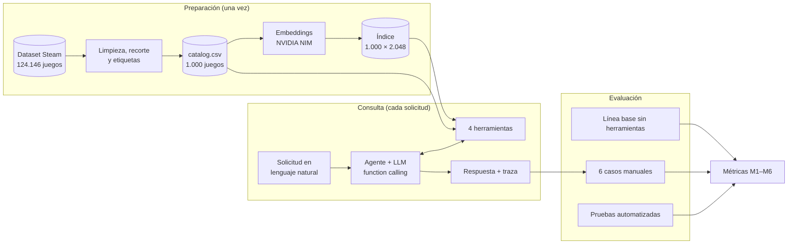
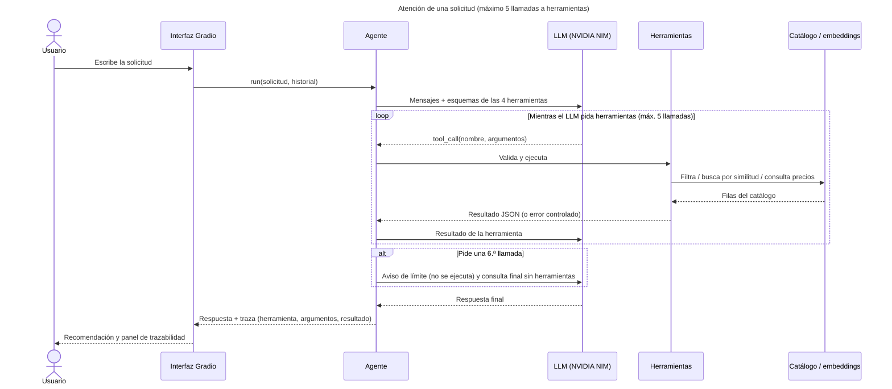

# Asistente conversacional para descubrir videojuegos de Steam

**Autores:** David Ramírez Agudelo, Laura Ortiz Usme, Samuel Hernando Echeverri  
**Curso:** SI3003 Inteligencia Artificial · Proyecto final, opción B (agente con herramientas) · **Fecha:** 2026-11-12

## 1. Introducción

Elegir un videojuego es difícil cuando se tiene una idea general («algo relajante para jugar con amigos en Mac») pero
no se conocen los géneros o etiquetas con que la tienda organiza su catálogo. Además, un modelo de lenguaje que
responde de memoria puede recomendar juegos o precios que no corresponden a los datos.

Este proyecto es un agente conversacional que interpreta la solicitud y decide qué herramientas usar sobre un catálogo
real de Steam: filtros exactos, búsqueda semántica, ficha de un juego y cálculo de precios. Responde solo con lo que esas
herramientas devolvieron. Su aporte son recomendaciones **verificables**: cada título, precio y sistema operativo se puede
rastrear en la traza de llamadas que muestra la interfaz.

## 2. Objetivo

**General:** desarrollar un agente conversacional con herramientas que recomiende videojuegos de un catálogo de Steam a
partir de solicitudes en lenguaje natural, respaldando cada recomendación en datos consultados.

**Específicos:**

1. Implementar cuatro herramientas cuyos resultados cumplan el 100 % de los filtros obligatorios (precio máximo,
   sistema operativo, género y etiquetas), verificado con pruebas automatizadas.
2. Evaluar 6 casos manuales según la elección de herramienta, el respaldo de los títulos y la exactitud de precios y totales.
3. Comparar con una línea base sin herramientas (mismo modelo y mismas solicitudes) y documentar la elección del modelo.

## 3. Descripción de los datos

| Aspecto | Valor |
|---|---|
| Fuente | [Steam Games Dataset (FronkonGames)](https://huggingface.co/datasets/FronkonGames/steam-games-dataset), Hugging Face, revisión `6c21457`, consultada el 2026-11-11 |
| Obtención | `scripts/prepare_data.py`: librería `datasets`; las etiquetas, de `games.csv` de la misma revisión |
| Tamaño | 124.146 juegos en origen → catálogo de 1.000 juegos × 12 columnas (`data/catalog.csv`, 533 KB) |
| Índice semántico | 1.000 × 2.048 embeddings de las descripciones (`data/catalog.embeddings.npy`, 8,2 MB) |
| Variables | `app_id`, `name`, `description`, `genres`, `tags`, `price` (USD), `windows` / `mac` / `linux`, `positive` / `negative` (reseñas), `release_date` |

**Preprocesamiento** (conteos de `data/catalog_info.json`): 124.146 → 124.145 con título y precio válidos → 110.602
con inglés soportado → 110.527 con descripción de al menos 60 caracteres → 109.046 con descripción en inglés → 107.262
sin títulos duplicados → **1.000** con más reseñas. Se normalizan precios, listas y fechas.

**Limitaciones y sesgos.** *Popularidad:* el recorte toma los 1.000 juegos con más reseñas y deja fuera títulos nicho o
recientes. *Etiquetas recuperadas:* la columna `tags` del parquet llega vacía en todas las filas; se completó desde
`games.csv`, corrigiendo su cabecera desalineada, y coincide con esa fuente en los 1.000 juegos. *Precios:* son de una
captura fija con el descuento vigente entonces (Stardew Valley, 8,99 USD con un 40 %); 152 juegos tienen precio 0,
incluidos valores dudosos como *Grand Theft Auto V Legacy*. *Idioma:* las descripciones están en inglés.

**Licencia:** la ficha declara `license: mit`, referido al código de recolección, sin términos adicionales para los
datos. Se conserva la atribución a FronkonGames y el uso es académico. Más detalle en
[`docs/datos_detalle.md`](docs/datos_detalle.md) y [`data/README.md`](data/README.md).

## 4. Metodología

**Etapas:** (1) datos: limpieza, recorte y recuperación de etiquetas; (2) indexado: embeddings con NVIDIA NIM, generados
una vez y validados con el hash del catálogo; (3) agente: *function calling* con 4 herramientas Python, sin
entrenamiento; (4) evaluación: pruebas con un modelo simulado, 6 casos reales valorados a mano y una línea base sin
herramientas; (5) despliegue en Gradio, local o en Colab.

| Decisión | Justificación |
|---|---|
| Agente con herramientas, no RAG | Las solicitudes mezclan preferencias semánticas («relajante») con condiciones exactas (precio, sistema, total), que se resuelven con filtros y cálculos sobre la tabla. La búsqueda semántica es una herramienta más. |
| LLM `mistralai/mistral-large-4-1t-a52b` | El previsto (`meta/llama-3.3-70b-instruct`) fue retirado (`410 Gone`). Entre los disponibles en la cuenta gratuita, respondió rápido y con llamadas válidas ([detalle](docs/tecnologias_y_modelos.md)). |
| Embeddings `nvidia/nemotron-3.5-embed-1b` | Sustituye al previsto, también retirado (`410`). Usa `input_type` `passage` para el catálogo y `query` para las consultas. |
| Temperatura 0,2 | Elección de herramientas y respuestas más estables. |
| Máximo de 5 llamadas por solicitud | Acota coste y latencia con el límite de peticiones gratuito. Una 6.ª llamada no se ejecuta y el modelo responde con lo reunido. |
| Orden por relevancia de etiquetas | Se añadió tras la primera evaluación: primero los juegos con las etiquetas pedidas entre sus 5 más votadas, luego entre las 10. La popularidad desempata. |

**Métricas:** **M1** % de juegos devueltos que cumplen los filtros; **M2** valoración manual (correcto / parcial /
incorrecto); **M3** títulos enumerados que no existen en el catálogo; **M4** títulos del catálogo mencionados que
ninguna herramienta devolvió; **M5** importes en USD que no coinciden con el catálogo; **M6** llamadas por caso y
latencia. M3–M5 los calcula `run_evaluation.py --metrics` con el mismo código para agente y línea base, y se revisan a mano.



## 5. Diagrama de interacción (UML)

En producción, el usuario conversa en Gradio. El agente envía al LLM la solicitud y los esquemas de las herramientas.
Cada herramienta que el modelo pide se ejecuta localmente sobre el catálogo y el índice, y su resultado vuelve al
modelo. Tras un máximo de 5 llamadas, el modelo redacta la respuesta y la interfaz la muestra con la traza.



Detalle del ciclo, los errores y cada herramienta: [`docs/agente_y_herramientas.md`](docs/agente_y_herramientas.md).
Interfaz: [`docs/interfaz.md`](docs/interfaz.md).

## 6. Resultados

Condiciones: catálogo de 1.000 juegos, `mistralai/mistral-large-4-1t-a52b`, temperatura 0,2 y máximo de 5 llamadas.
Agente evaluado el 2026-11-11; línea base, el 2026-11-12. Detalle en
[`docs/pruebas_y_evaluacion.md`](docs/pruebas_y_evaluacion.md) y [anexo de trazas](results/anexo_trazas_casos_3_y_6.md).

**M1:** 115 pruebas automatizadas, todas pasan, incluida la re-verificación fila a fila de los filtros. En el caso 1
real, los 10 juegos devueltos cumplen `Shooter` + `Co-op` + ≤ 10 USD, antes y después del cambio de orden.

**Agente frente a línea base** ([métricas](results/metricas_20261112_161103.md) · línea base: [1.ª ejecución](results/linea_base_20261112_135522.md), [2.ª ejecución](results/linea_base_20261112_160146.md)):

| Caso | Agente: M2 | Agente: llamadas | Agente: M3 / M4 / M5 | Línea base: M3 / M5 |
|---|---|---|---|---|
| 1 Filtros | Correcto | 1 | 0 / 0 / 0 | Sin respuesta (1.ª: timeout; 2.ª: vacía, `finish_reason=length`) |
| 2 Semántica | Correcto | 1 | 0 / 0 / 0 de 7 importes | 1 (*A Short Hike*) / 4 de 4 importes (2.ª) |
| 3 Combinada | Correcto | 2 | 0 / 0 / 0 de 5 importes | Sin respuesta (1.ª: timeout; 2.ª: vacía, `length`) |
| 4 Ficha | Correcto | 1 | 0 / 0 / 0 | 0 / 0 de 1 importe (2.ª) |
| 5 Título inexistente | Correcto | 1 | 0 / 0 / 0 | 1 (*Metroid Prime Remastered*) / 4 de 4 importes (1.ª) |
| 6 Límite de llamadas | Correcto (con matiz) | 5 | 0 / 2\* / 0 | 0 / 3 de 3 importes (2.ª) |

Los casos 1 y 3 del agente son los del código final; el resto, de la ejecución de los seis casos. \*Son los dos títulos
que el agente declaró pendientes, sin dar datos de ellos.

**La línea base tiene 4 casos válidos de 6** (2, 4, 5 y 6), reunidos en dos ejecuciones:

- **1.ª ejecución** (60 s de espera, 3 reintentos): solo fue válido el caso 5. Hubo 4 timeouts y 1 respuesta vacía.
- **2.ª ejecución** (casos 1–4 y 6; 180 s de espera, 1 reintento): fueron válidos los casos 2, 4 y 6. Los casos 1 y 3
  volvieron vacíos por agotar el máximo de tokens (`finish_reason=length`).

En los cuatro casos válidos, el modelo sin herramientas dio precios de memoria. El catálogo es una captura fija y los
precios de Steam cambian, así que estas diferencias miden la falta de respaldo en los datos consultados, no si los
precios eran correctos en otra fecha.

- **Caso 2:** los 4 precios no coinciden con el catálogo. Por ejemplo, Stardew Valley a 14,99 USD (catálogo: 8,99) y
  PowerWash Simulator a 24,99 (12,49). *A Short Hike* no figura en el catálogo.
- **Caso 5:** *No Man's Sky* a 59,99 (23,99), *Starfield* a 69,99 (41,99) y *Outer Wilds* a 24,99 (14,99).
  *Metroid Prime Remastered* no figura en el catálogo.
- **Caso 6:** 3 de 3 importes no coinciden: *GTA V Legacy* a 29,99 (0), y Terraria y Garry's Mod a 9,99 (4,99). Además,
  indica Counter-Strike 2 solo para Windows, mientras que el catálogo dice Windows y Linux.
- **Caso 4:** precio (gratis) y sistemas (Windows y Linux) coinciden con el catálogo.

**(a) Antes y después del orden por relevancia de etiquetas:**

| Caso | Métrica | Antes ([172348](results/evaluacion_20261111_172348.md)) | Después ([173037](results/evaluacion_20261111_173037.md), [174341](results/evaluacion_20261111_174341.md)) |
|---|---|---|---|
| 1 | Juegos con `Co-op` entre sus 5 etiquetas más votadas | 2 de 10 (los otros 8, en las posiciones 11–15) | 9 de 10 (todos en las posiciones 1–6) |
| 1 | M4, títulos sin respaldo | 1 («Left 4 Dead», citado como ejemplo) | 0 |
| 3 | Llamadas | 3 (repitió la búsqueda: salió DAVE THE DIVER) | 2 |
| 3 | Total (herramienta = respuesta = catálogo) | 26,17 USD | 46,97 USD |

**(b) Modelos alternativos:** no hay tabla, porque las salidas de esas pruebas no se guardaron en `results/` y no son
trazables. La elección se documenta en [`docs/tecnologias_y_modelos.md`](docs/tecnologias_y_modelos.md).

**Qué funcionó:** el agente eligió herramientas adecuadas en los 6 casos, no enumeró títulos fuera del catálogo ni dio
importes distintos de los del catálogo, los totales salen de `calcular_total` y, ante un título inexistente, dijo que no
estaba. Sin herramientas, el mismo modelo dio precios que no coinciden con el catálogo en 3 de sus 4 casos válidos
(11 de 12 importes) y nombró 2 títulos que no figuran en él.

**Qué no funcionó:** el orden solo por popularidad devolvía «cooperativos» poco representativos (corregido con el orden
por relevancia). En el caso 6 el modelo se detuvo solo en la 5.ª llamada, así que el corte de la aplicación únicamente
está verificado con el modelo simulado. Las consultas vagas en español dan similitudes bajas (≈ 0,19). En el caso 3, dos
de los tres juegos son de la misma saga.

**Limitaciones:** son 6 casos valorados a mano, y M3 y M5 son heurísticas.

**Colab (2026-11-12):** el notebook funcionó en Colab: dependencias, clave por secretos, clonado, prueba del agente e
interfaz Gradio. Hubo `APITimeoutError` intermitentes, en la primera consulta del agente y en una consulta de Gradio, y
el reintento funcionó. La latencia en Colab no se midió, y allí no se ejecutaron la evaluación ni la preparación del catálogo.

**Latencia local:** cada herramienta tardó 0–315 ms. El tiempo total del agente no quedó registrado; el script ya lo
registra en ejecuciones nuevas. En la línea base (2026-11-12), las respuestas válidas tardaron 47,7–57,0 s en la 2.ª
ejecución y 153,7 s en la 1.ª, con reintentos. Cada timeout de la 1.ª ejecución tardó unos 244 s.

Los modelos gratuitos pueden retirarse sin aviso, como pasó con los dos previstos.

## 7. Reproducibilidad

**Requisitos:** Python 3.11, Git y una clave gratuita de [NVIDIA NIM](https://build.nvidia.com) en `.env`
(`NVIDIA_API_KEY`), que nunca se sube al repositorio. El repositorio ya incluye el catálogo y el índice.

```bat
git clone -b proyecto-final-videojuegos https://github.com/lauraortizusme/IntroAI_2026.git steam-game-agent
cd steam-game-agent
py -3.11 -m venv .venv
.venv\Scripts\activate
python -m pip install -r requirements-dev.txt -r requirements-data.txt
copy .env.example .env
notepad .env
python -m pytest
python src\app.py
```

**Opcional:** regenerar datos con `python scripts\prepare_data.py` (≈ 590 MB; usa la última revisión del dataset) y
`python scripts\build_embeddings.py` (≈ 32 peticiones). Evaluar con `python scripts\run_evaluation.py` (≈ 15 peticiones,
`--only 1,3`), la línea base con `--baseline` (6 peticiones; `--timeout`, `--max-retries`) y las métricas sin API con `--metrics results\<archivo>.json`.
En Colab: `notebooks/steam_agent_colab.ipynb`, con el secreto `NVIDIA_API_KEY`.

```
.
├── README.md · requirements*.txt · .env.example · pytest.ini
├── data/        catálogo real e índice (incluidos), catálogo de muestra ficticio, README de datos
├── src/         app.py (Gradio) · agent.py (ciclo y límite) · tools.py (4 herramientas) · catalog.py · embeddings.py · config.py
├── scripts/     prepare_data · build_embeddings · run_evaluation · make_notebook · make_sample_data
├── notebooks/   steam_agent_colab.ipynb
├── tests/       115 pruebas automatizadas (sin red)
├── results/     evaluaciones, línea base, métricas y anexo de trazas
└── docs/        agente y herramientas, interfaz, datos, tecnologías, pruebas y evaluación
```

## Uso de herramientas de IA

Se usó Claude Code (Anthropic) como asistente de programación para el código, las pruebas y la documentación. Los
autores revisaron los resultados y confirmaron las valoraciones de la evaluación manual.

## Referencias

- FronkonGames. *Steam Games Dataset*. Hugging Face, revisión `6c21457b9ebf0a6a7f5b91e11281d65d456ea30e` (consultada el
  2026-11-11). https://huggingface.co/datasets/FronkonGames/steam-games-dataset
- NVIDIA. API de NVIDIA NIM y catálogo de modelos. https://build.nvidia.com
- NVIDIA. *Function (Tool) Calling with NVIDIA NIM for LLMs*. https://docs.nvidia.com/nim/large-language-models/1.10.0/function-calling.html
- SI3003 Inteligencia Artificial: [agentes (Lecture11)](https://github.com/EAFIT-IA/si3003-artificial-intelligence/tree/main/notebooks/Lecture11)
  y [RAG (lecture10)](https://github.com/EAFIT-IA/si3003-artificial-intelligence/tree/main/notebooks/lecture10).
