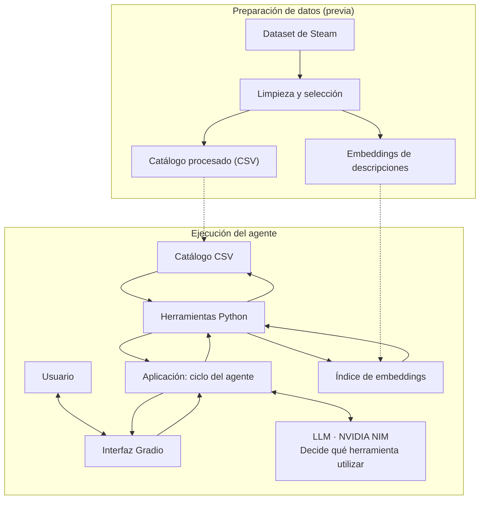

# Agente y herramientas: comportamiento detallado

Detalle del funcionamiento que el README resume. Todo lo descrito aquí está cubierto por las pruebas automatizadas (`tests/`).

## Alcance

## Funcionalidades incluidas

| Tarea | Ejemplo | Herramienta |
|---|---|---|
| Búsqueda con criterios concretos | «Un shooter cooperativo por menos de 10 USD» | `buscar_juegos` |
| Búsqueda por descripción libre | «Algo relajante, parecido a un juego de granja» | `buscar_similares` |
| Consulta de un título | «¿Cuánto cuesta y en qué sistemas funciona [juego]?» | `detalle_juego` |
| Cálculo de precios | «¿Cuánto cuestan juntos estos tres juegos?» | `calcular_total` |
| Solicitud combinada | «Busca juegos relajantes por menos de 15 USD en Mac y calcula cuánto cuestan los dos primeros» | Varias herramientas |

En este proyecto, **plataforma** se refiere a sistema operativo de PC:
Windows, macOS o Linux. El catálogo corresponde a Steam; no incluye
consolas ni otras tiendas.

## Fuera del alcance

- Comprar juegos, generar enlaces de pago o integrarse con la tienda de Steam.
- Consultar precios o disponibilidad en tiempo real.
- Analizar reseñas completas u opiniones de usuarios.
- Personalizar recomendaciones mediante el historial o la cuenta del jugador.
- Consultar catálogos de consolas, dispositivos móviles u otras tiendas.
- Implementar varios agentes o desplegar el sistema como servicio de producción.

## Arquitectura y ciclo de ejecución

El sistema se organiza en dos procesos: **preparación de datos**, que se
realiza antes de ejecutar el agente, y **consulta**, que se repite cada
vez que el usuario envía una solicitud.

## Ciclo de ejecución

1. El usuario envía una solicitud desde la interfaz.
2. La aplicación envía al modelo el mensaje, el historial pertinente (últimos 6 turnos, solo texto) y las descripciones de las herramientas disponibles.
3. El modelo decide si puede responder o si necesita solicitar una herramienta.
4. Cuando solicita una herramienta, la aplicación valida sus argumentos, la ejecuta y registra el nombre, los argumentos y el resultado.
5. La aplicación devuelve el resultado al modelo, que puede responder o solicitar otra herramienta.
6. El ciclo termina cuando el modelo produce una respuesta final o se alcanza el límite de llamadas.
7. La interfaz muestra la respuesta y la traza de ejecución.

## Límite de llamadas y errores

Se establece un máximo de **cinco llamadas a herramientas por solicitud
del usuario** (`MAX_TOOL_CALLS`). Se considera que el límite se alcanza cuando el modelo pide una llamada
adicional: esa llamada **no se ejecuta**, la aplicación le responde con un aviso de límite y realiza una última
consulta al modelo sin habilitar herramientas, para que responda con la información reunida y advierta que la
búsqueda quedó incompleta. Si el modelo no lo menciona, la interfaz añade el aviso. Cinco llamadas exactas que
resuelven la tarea no cuentan como búsqueda incompleta.

Las herramientas validan sus argumentos y devuelven resultados
estructurados. Casos como un juego inexistente, argumentos inválidos o
una búsqueda sin coincidencias se comunican al modelo como
resultados controlados (`ok: false` + `tipo_error`), en lugar de interrumpir el ciclo con una
excepción no gestionada. Los fallos de red o de la API del modelo se capturan y se muestran como mensaje en el chat.

## Las cuatro herramientas

Las cuatro herramientas se implementan como funciones Python
independientes (`src/tools.py`) y se describen al modelo mediante esquemas de function
calling.

| Herramienta | Propósito | Argumentos principales | Resultado |
|---|---|---|---|
| `buscar_juegos` | Aplicar filtros exactos al catálogo | `genero`, `tags`, `precio_max`, `plataforma`, `limite` | Juegos que cumplen los criterios, con sus datos relevantes |
| `buscar_similares` | Encontrar descripciones cercanas semánticamente a una solicitud | `descripcion`, `k`, filtros opcionales | Juegos más similares y puntajes de similitud |
| `detalle_juego` | Consultar la ficha de un título | `nombre` | Datos del juego o aviso de que no se encontró |
| `calcular_total` | Calcular el costo de varios títulos | `nombres` | Precios individuales, suma y promedio, o aviso de títulos no encontrados |

`buscar_juegos` se encarga de las condiciones exactas;
`buscar_similares` identifica cercanía de significado. Cuando una
solicitud combina ambas, el diseño asegura que los filtros
obligatorios —como precio máximo y sistema operativo— se apliquen y
verifiquen, aunque también se utilice similitud semántica: los filtros se aplican **antes** de ordenar por
similitud (así siempre se devuelven hasta `k` juegos válidos) y luego se **re-verifican fila a fila** con una
implementación independiente. El resultado incluye `verificacion_filtros`.

`calcular_total` recibe nombres de juegos y consulta sus precios en el
catálogo. No recibe expresiones de código ni precios inventados por el
modelo; cualquier argumento no declarado se rechaza.

**Detalles de comportamiento** (cubiertos por las pruebas automatizadas):

- `precio_max` es inclusivo (precio ≤ máximo); `0` devuelve solo juegos gratuitos. `tags` exige **todas** las etiquetas.
- Orden de `buscar_juegos`: las etiquetas de Steam vienen ordenadas por votos, así que, si se piden etiquetas, primero van
  los juegos en los que **todas** están entre las 5 más votadas, luego entre las 10 más votadas y luego el resto; dentro
  de cada grupo, por reseñas positivas (la popularidad desempata). Sin etiquetas, el orden es solo por popularidad.
  Este criterio se introdujo tras la evaluación real (ver «Análisis de resultados»).
- `plataforma` acepta sinónimos (`mac`, `macOS`, `OS X`…) y se normaliza a `windows | mac | linux`.
- Si un género o etiqueta no existe, la herramienta devuelve el vocabulario válido para que el modelo se corrija (p. ej., «shooter» es una etiqueta, no un género).
- Los títulos se comparan sin distinguir mayúsculas, tildes ni signos, pero **solo por coincidencia exacta**: un título parecido nunca se toma por el pedido; se ofrece como sugerencia (siempre títulos reales del catálogo).
- `calcular_total` suma en centavos enteros (evita errores como `0.1 + 0.2 + 0.3 = 0.6000000000000001`), ignora duplicados y avisa de los títulos no encontrados.
- Las descripciones del catálogo están en inglés: el esquema de `buscar_similares` indica al modelo que redacte `descripcion` en inglés aunque el usuario escriba en español.

[← Volver al README](../README.md)
